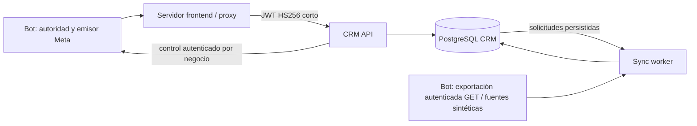

# CRM independiente: atención humana mediante el bot

Continuación del backend existente, no una reconstrucción. Rama de pruebas
`crm-staging-safety`, basada en `crm-railway-dockerfile@e451f5c`; preserva su
Dockerfile compatible con Railway. Ahora incluye operaciones autenticadas del bot,
sin un segundo emisor Meta. No promover a `43-CRM`, `42-actualizacion-de-precios`
o `crm-railway-dockerfile`. Solo el piloto Briosos está autorizado para una futura
activación; no se ha desplegado desde este entorno.

El runtime mantiene Python 3.12, FastAPI, Pydantic v2, SQLAlchemy 2/Alembic,
PostgreSQL y procesos `api` / `sync-worker`, sin Redis ni imports del bot.



## Guías vigentes

- [Prompt listo para Railway](../docs/RAILWAY_BRIOSOS_CRM_PROMPT.md): despliega solo
  Briosos desde el proyecto existente. El código frontend ya está integrado;
  Lovable solo requiere secretos privados y publicación, sin reimplementación.
- [Entrega operativa del piloto](../docs/CRM_PILOT_HANDOFF.md): contrato de control,
  configuración por servicio, Railway solo Briosos, botones/compositor Lovable,
  aceptación local y pasos pendientes para comprobar recepción física.
- [Contrato completo](docs/INTEGRATION.md): rutas reales, parámetros, cuerpos,
  respuestas, JWT, cabeceras del proxy y carencias. [OpenAPI](docs/openapi.json).
- [Staging reproducible](docs/STAGING.md): tres bases desechables, dos empresas,
  datos ficticios, configuración por servicio y verificación integral.
- [Acceso a fuentes](docs/SOURCE_ACCESS.md): permisos efectivos y SQL para revisión
  separada, exclusivamente una base/fachada nueva aislada. Nunca ejecutar en bots.
- [Runbook y requisitos pendientes del piloto](docs/RUNBOOK.md).
- `docs/VALIDATION.md` conserva el informe histórico del primer backend;
  `docs/STAGING_VALIDATION.md` documenta esta continuación.

## Fronteras actuales

`CRM_SOURCE_MODE=bot_api` permite leer una fuente real mediante la fachada GET
del bot y un secreto dedicado que no autoriza comandos. API usa otro secreto para
tomar control, responder y cerrar mediante el bot. Las fuentes PostgreSQL directas
siguen limitadas a loopback de pruebas; `postgres_readonly` no activa producción. El worker
rechaza SERVICE_ROLE_KEY administrativas: renombrarlas no reduce privilegios.
El adaptador HTTP heredado solo admite transportes simulados en pruebas.

El lector dedicado verifica permisos efectivos, RLS forzado, membresías,
herencia/PUBLIC, secuencias, columnas/tipos y funciones peligrosas antes de leer.
No usa default_transaction_read_only como barrera. No se cambian roles/políticas
de Supabase actuales. PUBLIC impide afirmar privilegios acotados en un Supabase
compartido sin revisión externa o una fachada aislada endurecida.

Las notificaciones están apagadas por defecto y son opcionales mediante
`NOTIFICATIONS_ENABLED=true`, `VAPID_PRIVATE_KEY` y `VAPID_SUBJECT` privados en
API y sync. `GET /v1/push/config` autentica al perfil actual y expone solo la clave
pública derivada y el estado real de configuración. Sin claves válidas no anuncia
que Web Push esté listo ni contacta al proveedor. El dispatcher usa un hilo local
separado dentro del worker existente para no bloquear la ingesta de mensajes.
Ver [activación y rollback](docs/RUNBOOK.md#activación-web-push).
No hay revocación/administración global de identidades, tareas globales o métricas
de tiempos/SLA. Un profile compartido por marca o Admin comparte
leído y preferencias; no identifica individualmente a cada empleado. No hay
envío Meta independiente: el compositor se conecta a comandos del bot mediante
CRM; tomar control, responder, cerrar y reanudar existen bajo flags por negocio.
Las capabilities describen esas operaciones; no certifican un despliegue remoto.

## Arranque y migraciones locales

Desde `crm/`, con Python 3.12 y PostgreSQL 17 desechable:

```bash
python3.12 -m venv .venv
.venv/bin/python -m pip install -e '.[dev]'
# Seguir STAGING.md para crear fixtures y generar api.env/worker.env fuera del checkout.
# En terminal API limpia, cargar api.env y ejecutar:
.venv/bin/alembic upgrade head
.venv/bin/uvicorn crm_service.api:create_app --factory --host 127.0.0.1 --port 8080 --no-access-log
# En terminal worker limpia, cargar worker.env y ejecutar un paso acotado:
.venv/bin/python -m crm_service.worker --once --business synthetic_one
# O proceso periódico:
.venv/bin/python -m crm_service.worker
```

0003_bot_commands actualiza únicamente PostgreSQL CRM después de 0002_sync_controls.
Los comandos del bot necesitan además su propio esquema, según la guía piloto;
no aplicar ese SQL en los tres negocios activos. /ready comprueba migraciones
y base CRM; no garantiza baseline. Consultar /v1/sync-status para cada negocio.
La configuración no carga .env automáticamente.

## Configuración por servicio

| Servicio | Configuración |
| --- | --- |
| crm-api | CRM_DATABASE_URL, CRM_JWT_SECRET, CRM_SYNC_SECRET, CRM_BUSINESSES; en piloto bot_api, BUSINESS_BOT_API_URL, BUSINESS_HUMAN_CONTROL_ENABLED y BUSINESS_BOT_CONTROL_SECRET. Notificaciones false. Sin claves de lectura de fuentes. |
| sync-worker | Misma base CRM y registro; en piloto bot_api, BUSINESS_BOT_API_ENABLED y BUSINESS_BOT_SOURCE_SECRET. Sintético conserva lectores PostgreSQL dedicados. Nunca claves administrativas del bot. |
| Proxy frontend | URL CRM y CRM_JWT_SECRET solo servidor. Resolver identidad y empresas antes de firmar. Eliminar Origin y Sec-Fetch-Site. No enviar contraseñas Lovable al CRM ni secretos/JWT CRM al navegador. |
| Loader sintético | ADMIN exclusivo del clúster local desechable para fixtures/roles; nunca en API/worker. Genera api.env/worker.env 0600. |

BUSINESS es el identificador en mayúsculas. Settings.from_env(service='api') no
carga DSNs lectores; service='worker' sí. POST /internal/sync persiste una solicitud
con business_id e idempotency_key, autenticada por X-CRM-Sync-Secret: el worker la
consume. GET /internal/sync/{id} consulta estado. No se requieren claves en API.
El proxy usa HS256 con issuer chatty-catalog-compass, audience whatsapp-crm,
profile, allowed_businesses, iat y exp; máximo 300 segundos. Ver contrato completo.

## Presupuestos por negocio y ejecución

| Variable | Default | Rango/efecto |
| --- | --- | --- |
| SYNC_PAGE_SIZE | 500 | 1–1000 filas/página |
| SYNC_MAX_PAGES | 20 | 1–1000 intentos globales entre todas las tablas |
| SYNC_MAX_SECONDS | 15 | Finito, 0.05–120 s, deadline cooperativo + timeout de consultas restante |
| SYNC_MAX_REQUESTS | 100 | 4–5000, incluye auditoría, reintentos y ajustes de timeout |
| SYNC_MAX_CONNECTIONS | 1 | Techo 1–4; lector actual reutiliza una única conexión |
| SYNC_MAX_PROJECTIONS | 50 | 1–1000 conversaciones modificadas/paso |
| SYNC_MAX_HISTORY_MESSAGES | 10000 | 1–100000/conversación; superar límite falla, nunca trunca silenciosamente |
| SYNC_RECONCILE_INTERVAL_SECONDS | 3600 | 30–86400, una página histórica por intervalo y cursor rodante |
| SYNC_BACKOFF_BASE_SECONDS / SYNC_BACKOFF_MAX_SECONDS | 30 / 1800 | Base 1–3600, máximo 1–86400 y >= base; exponencial por empresa |
| SYNC_INTERVAL_SECONDS | 30 | 5–3600 s entre vueltas |

--once ejecuta un paso, no un backfill ilimitado. partial confirma progreso y
conserva baseline inicial incompleto; repetir continúa cursores. failed sale con
código 1 y aplica backoff; backoff evita nuevas lecturas hasta next_retry_at.
Cada negocio dispone de su presupuesto y no bloquea indefinidamente a los demás.
Los timeouts del driver tienen granularidad; no se promete cancelación exacta al
milisegundo. Las métricas incluyen páginas, requests, filas retornadas (también
auditoría), duración total/de lecturas y pico de conexiones.

Mensajes nuevos usan watermark. Clientes/estados/handoffs recorren keysets
reanudables porque no siempre hay updated_at fiable. Solo se reproyectan contactos
modificados; el historial antiguo se reconcilia por páginas espaciadas. La copia
es eventualmente consistente y no propaga borrados automáticamente.
La clasificación sigue siendo pura y central, con metadata primero y fallback
(created_at,id). Leído por actor no cambia el bucket.

## Verificación

```bash
.venv/bin/ruff check .
.venv/bin/ruff format --check .
.venv/bin/mypy crm_service
export CRM_TEST_DATABASE_URL=postgresql+psycopg://agent@127.0.0.1:55432/crm_test
.venv/bin/pytest -q
```

La suite usa PostgreSQL desechable real, verifica contrato, permisos/RLS/PUBLIC,
upgrades, presupuestos/reanudación y datos de dos empresas. No llama a producción.
Los archivos Railway son referencia de configuración; esta tarea no despliega.
