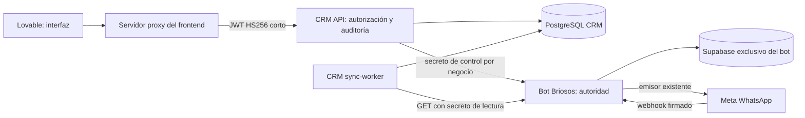

> Histórico del piloto anterior. Para la entrega multimedia/multiempresa usar únicamente [CRM_MEDIA_DEPLOYMENT.md](CRM_MEDIA_DEPLOYMENT.md); las instrucciones de credencial personal o restricción Briosos de este documento no aplican a esa entrega.

# Piloto operativo CRM: Briosos

Esta guía sustituye las restricciones antiguas de «visor sintético» para el piloto
autorizado de Briosos. No activa Tanaka, Memo's ni Velvet. No se ha desplegado,
migrado ni contactado ningún servicio productivo desde este entorno.

La rama de trabajo es `crm-staging-safety`. No fusionar ni hacer push a `43-CRM`,
`42-actualizacion-de-precios` o `crm-railway-dockerfile`. El arreglo existente de
`crm/Dockerfile` se conserva. El frontend existente y las instrucciones/catálogos
del bot se conservan. La integración de botones/compositor ya se aplicó, con
autorización explícita, en chatty-catalog-compass main@6060d7828cc7ff58fb2b644911b847404a71302d.
El código está publicado en Git; configuración privada, activación y comprobación
física del piloto siguen pendientes. No reaplicar el parche archivado sobre main.

Base bot: `c5531d0b53e8e77de5b41bb2f5c86a69a59c5390`; integración CRM:
`af45254911e38d80434ac6d28ac875a0ca98c626`. Para la entrega conjunta, incluidos
los arreglos posteriores de entrega, usar el HEAD comunicado en el informe final. En Railway verificar el SHA de cada
servicio; no basta que el nombre de la rama coincida.

## Distribución de servicios

Mantener **un despliegue independiente de bot por negocio**, con su propio número
Meta, Supabase y cola/Redis si ya la usa. Conservar los proyectos Railway aislados
de los negocios existentes según AGENTS.md. No se necesita crear otro proyecto
para probar Briosos: su proyecto de pruebas ya contiene el CRM. Compartir proyecto
no significa compartir variables, bases o colas. Para negocios nuevos, un proyecto
Railway por bot facilita permisos, costes y recuperación, aunque Railway permite
servicios separados dentro de un proyecto con aislamiento explícito.

El CRM multiempresa comparte API, sync-worker y PostgreSQL CRM. No requiere Redis.
El Redis del bot, si existe, sigue siendo exclusivo del bot.



El CRM nunca recibe claves administrativas Supabase, tokens Meta o contraseñas de
Lovable. Solo el bot escribe sus tablas operativas y usa su transporte Meta
existente. Los nuevos estados se serializan en PostgreSQL del bot; la coordinación
no depende exclusivamente de un bloqueo en memoria o Redis.

## Proveedores y garantías

`HUMAN_SUPPORT_PROVIDER` acepta `chatwoot`, `crm`, `bot_only`. Si está vacío conserva
la selección anterior mediante `CHATWOOT_ENABLED`. No habilitar flags nuevos en
los tres negocios activos. En `crm` no se crean tickets Chatwoot. Un handoff guarda
motivo, pausa y evento `HANDOFF:`. Desactivar Chatwoot o volver al flag bot_only no
libera un caso CRM abierto; tampoco `/reset` del cliente.

Fases autoritativas: `ai`, `waiting` (handoff sin responsable), `pausing` (se bloqueó
la IA pero falta esclarecer un envío automático ya reservado), `human` (pausa
confirmada). Solo `human` con `confirmed=true`, propietario correcto,
`can_send=true` y ventana vigente habilita una respuesta. La toma incrementa una
versión durable, invalida seguimientos y bloquea reservas automáticas nuevas.
Trabajos en cola conservan su versión original: cerrar y reabrir no los reactiva.
Un envío Meta ya iniciado no puede retirarse; debe terminar antes de confirmar la
pausa. Un resultado automático incierto mantiene `pausing` hasta su confirmación.

Las respuestas humanas actuales son texto, hasta 4096 caracteres, dentro de las
24 horas del timestamp original recibido de Meta. Un timestamp ausente o vencido
impide texto libre. No se implementan adjuntos humanos, plantillas fuera de
ventana, cambio forzado de propietario ni cancelación de un envío ya aceptado.

## Contrato definitivo de atención

El resto de rutas se documenta en [INTEGRATION.md](../crm/docs/INTEGRATION.md) y el
inventario verificable es [openapi.json](../crm/docs/openapi.json).

Sea `C=/v1/conversations/{business_id}/{phone_number}`. Todas estas rutas son
servidor frontend → CRM con `Authorization: Bearer <JWT>`. `profile` es una
identidad individual estable obtenida del login, nunca un perfil compartido por
marca. El servidor decide `allowed_businesses`; una empresa ajena devuelve 403.

| Método/ruta CRM | Cuerpo | Respuesta |
| --- | --- | --- |
| `GET C/control` | ninguno | 200 `Control` leído del bot, sin usar la copia del inbox |
| `POST C/take` | `command_id`, `expected_version`, `reason` opcional | 200 confirmado; 202 pendiente/incierto |
| `POST C/messages` | `command_id`, `expected_version`, `text` | 200 aceptado/fallido/conocido; 202 pendiente/incierto |
| `POST C/close` | `command_id`, `expected_version`, `reason` opcional | 200 confirmado con fase `ai`; 202 si resultado incierto |
| `GET C/commands/{command_id}` | ninguno | estado durable actualizado del comando, 200 o 202 |

`command_id`: 1–100 caracteres `[A-Za-z0-9_.:-]`, primero alfanumérico; generar UUID una sola vez por
acción. `expected_version`: entero >=0 del último `GET C/control`; es diferente de
`version` de notas/etapas en el CRM. `reason`: 1–255 caracteres, default
`Operator action` en el CRM. `text`: 1–4096 caracteres no vacíos.
Se rechazan campos adicionales: no aceptar actor, destino, URL, token o empresa
desde el cuerpo del navegador. El CRM añade `actor` desde el JWT.

Ejemplo sintético de toma:

```json
{"command_id":"demo-take-001","expected_version":1,"reason":"Atención solicitada"}
```

Respuesta `Control` de ejemplo (versiones y fecha son ilustrativas):

```json
{"business_id":"briosos","phone_number":"573000000001","provider":"crm","phase":"human","version":2,"owner":"employee-007","is_paused":true,"confirmed":true,"can_send":true,"window_expires_at":"2030-01-01T12:00:00+00:00"}
```

Respuesta de comando:

```json
{"command_id":"demo-reply-001","status":"accepted","provider_message_id":"wamid.SYNTHETIC.001","control":{"business_id":"briosos","phone_number":"573000000001","provider":"crm","phase":"human","version":3,"owner":"employee-007","is_paused":true,"confirmed":true,"can_send":true,"window_expires_at":"2030-01-01T12:00:00+00:00"}}
```

Estados: `confirmed`, `pending`, `accepted`, `delivered`, `read`, `failed`,
`unknown`; además `rejected` y `not_forwarded` en el ledger del CRM. `accepted`
solo confirma aceptación del proveedor. `delivered/read` requieren webhook Meta
firmado del número correcto y se guardan también en metadata del mensaje asesor.
Los cambios generan hechos DELIVERY_STATUS idempotentes que el siguiente polling
incremental consume; un fallo vuelve a Por responder sin esperar reconciliación
histórica. Los recibos no reabren casos ni marcan no leído, y un sent tardío no
borra un fallo confirmado.
`failed` es un resultado de envío fallido, no un éxito aunque HTTP sea 200.

401 JWT inválido/vencido; 403 empresa o cabeceras de navegador; 409 versión,
propietario, ventana, pausa o clave idempotente incompatible; 422 cuerpo inválido;
503 bot/base indisponible en consulta. Errores normales FastAPI usan
`{"detail":"..."}`; un resultado de comando puede incluir `error` y `control:null`.
Una empresa sin atención habilitada devuelve 409. Un resultado POST ambiguo usa
202 y `unknown`, aun si el proxy perdió la respuesta.

Repetir una acción conserva exactamente command_id, cuerpo y versión originales.
El CRM registra antes de enviar; tras un timeout o caída no repite el POST, solo
consulta el comando del bot. No crear otra clave para «reintentar» un `unknown`.
Usar GET de estado. Si no hay recibo ni respuesta autoritativa, requiere diagnóstico
operativo: se bloquean otro envío humano y cierre para evitar duplicados. No hay
un endpoint que fuerce a «fallido» un resultado incierto. Para un fallo confirmado,
una nueva acción explícita del agente puede usar otra clave y versión fresca.

### Contrato interno del bot

Base `B=/internal/crm/v1/businesses/{business_id}/conversations/{phone}`.
`GET B/control`, `GET B/commands/{command_id}`, `POST B/take`, `POST B/messages`,
`POST B/close`. Header `X-CRM-Bot-Secret`; nunca JWT de usuario ni credenciales en
query. Mismos cuerpos más `actor` (1–200 caracteres) añadido por CRM. El bot admite
command_id hasta 160 caracteres; el límite público CRM es 100. Cada despliegue
rechaza otra empresa aunque el contacto coincida. No hay CORS para estas rutas;
rechazan Origin y Sec-Fetch-Site. El bot persiste control/comandos/intentos con
claves que incluyen business_id. Reserva y finalización se serializan con bloqueo
de fila; el historial `asesor` se inserta una sola vez en la misma transacción.

`GET /internal/crm/v1/businesses/{business_id}/source/{table}` es otra capacidad,
con header **distinto** `X-CRM-Source-Secret`. Tables permitidas: customers,
conversation_states, message_logs, handoff_deliveries. Query `limit` 1–1000,
default 500; `after` exclusivo (id numérico para mensajes, phone_number para otras
tablas). Respuesta: array de registros; `X-CRM-Data-Quality` contiene array JSON
de advertencias. Campos exactos en `crm_source_api.SOURCE_FIELDS`. Incluye fase,
versión, propietario y proveedor en estados. No expone SQL arbitrario, RPC ni
métodos de escritura; el transporte lector también bloquea cualquier método
distinto de GET/HEAD. La clave de lectura no autoriza operaciones de control.
Este modo soporta una fuente real con credencial limitada por la fachada del bot,
sin afirmar que el usuario PostgreSQL del propio bot tenga permisos limitados.

## Variables por servicio (sin secretos)

Valores entre `<...>` se configuran como secretos privados en Railway, nunca en
Git, Lovable cliente o chat. Generar dos secretos aleatorios distintos >=32
caracteres para control y exportación. No reutilizar claves de otros negocios.

Bot **solo Briosos**, conservar todas sus variables actuales Supabase/Meta/Gemini,
catálogos e instrucciones y su cola existente:

```dotenv
BUSINESS_ID=briosos
HUMAN_SUPPORT_PROVIDER=crm
CRM_CONTROL_ENABLED=true
CRM_BOT_CONTROL_SECRET=<secreto-control-briosos>
CRM_SOURCE_READ_ENABLED=true
CRM_SOURCE_READ_SECRET=<secreto-lectura-briosos>
WA_APP_SECRET=<app-secret-real-de-la-app-Meta-del-piloto>
```

`WA_APP_SECRET` firma callbacks, no es WA_TOKEN. Al seleccionar crm no se necesitan
credenciales Chatwoot; aunque queden variables antiguas no se utiliza Chatwoot.
Las variables de nuevas capacidades vienen deshabilitadas por defecto.

Ambos servicios CRM:

```dotenv
CRM_DATABASE_URL=<PostgreSQL-propio-del-CRM-formato-postgresql+psycopg>
CRM_JWT_SECRET=<secreto-compartido-solo-con-servidor-frontend>
CRM_SYNC_SECRET=<secreto-operacion-distinto>
CRM_BUSINESSES=briosos
CRM_SOURCE_MODE=bot_api
CRM_BOT_TEST_MODE=false
BRIOSOS_BOT_API_URL=https://<dominio-exclusivo-del-bot-piloto>
BRIOSOS_HUMAN_CONTROL_ENABLED=true
BRIOSOS_BOT_API_ENABLED=true
NOTIFICATIONS_ENABLED=false
SYNC_INTERVAL_SECONDS=30
SYNC_PAGE_SIZE=500
SYNC_MAX_PAGES=20
SYNC_MAX_SECONDS=15
SYNC_MAX_REQUESTS=100
SYNC_MAX_CONNECTIONS=1
SYNC_MAX_PROJECTIONS=50
SYNC_MAX_HISTORY_MESSAGES=10000
SYNC_RECONCILE_INTERVAL_SECONDS=3600
SYNC_BACKOFF_BASE_SECONDS=30
SYNC_BACKOFF_MAX_SECONDS=1800
```

Solo crm-api: `BRIOSOS_BOT_CONTROL_SECRET=<secreto-control-briosos>` y opcional
`CRM_BOT_TIMEOUT_SECONDS=20` (0.1–60 segundos). Solo sync-worker:
`BRIOSOS_BOT_SOURCE_SECRET=<secreto-lectura-briosos>`. El loader de configuración
ignora el secreto de lectura en API y el de control en worker. No añadir
SOURCE_SUPABASE_SERVICE_ROLE_KEY ni SOURCE_READONLY_DATABASE_URL en este modo.
Se requiere HTTPS y origen sin path, usuario, query o fragmento; no se siguen
redirects. El permiso loopback HTTP es exclusivo de `CRM_BOT_TEST_MODE=true` en
pruebas. Las URLs y credenciales son configuración servidor, nunca payload.

## Railway: desplegar únicamente el piloto

Estos pasos son para el operador/IA con acceso autorizado a Railway. No se han
ejecutado aquí. No crear más ramas ni cambiar la Source de servicios activos.

1. Identificar **el servicio Briosos de pruebas** y su Supabase exclusivo. Hacer
   backup de esa base. Revisar el diff SQL. Para un bot existente, ejecutar
   `supabase/upgrade_existing_brand.sql` solo allí, después de revisar el script
   completo y compatibilidad del esquema. No usar bootstrap sobre una instalación
   existente. Para una instalación nueva aislada usar `supabase/bootstrap.sql`.
   Ambos contienen el mismo bloque CRM CONTROL. No ejecutar nada en los tres
   Supabase activos. Esperar recarga del schema cache PostgREST tras crear RPCs.
2. En Railway, desactivar autodeploy mientras se configura. Solo en Briosos cambiar
   Source branch a `crm-staging-safety`, con el commit entregado; Root Directory
   `/`, configuración `railway.json`, start actual `python run_railway.py` (o el
   startCommand del archivo). Si usa un worker bot separado, actualizar **también
   ese worker del piloto** al mismo código/variables. No mezclar workers viejos y
   nuevos en la cola. Drenar/detener trabajos viejos antes de habilitar control.
3. Configurar las variables de Briosos anteriores en web y worker del bot y
   desplegar manualmente **solo esos servicios piloto**. Verificar su `/health` y
   que el webhook Meta del número piloto sigue apuntando al dominio correcto. Las
   llamadas Meta POST deben llevar firma válida con el App Secret correcto.
4. CRM API existente: misma rama entregada, Root Directory `/crm`, config
   `crm/railway.toml`, builder Dockerfile `/crm/Dockerfile`, preDeploy
   `alembic upgrade head`, healthcheck `/ready`. Mantener el arreglo Dockerfile
   existente. No usar el Dockerfile/arranque raíz del bot para el CRM.
5. CRM worker existente: Root Directory `/crm`, config `crm/railway.worker.toml`,
   start `python -m crm_service.worker`. Misma base CRM y código que API; iniciar
   después de que API haya migrado a `0003_bot_commands`. No agregar Redis al CRM.
6. Desde consola del **worker CRM**, con su configuración segura:
   `python -m crm_service.worker --once --business briosos`. Repetir pasos acotados
   hasta baseline completo; un resultado partial continúa cursores y no completa
   baseline. También se puede solicitar vía `/internal/sync` con secreto interno;
   la API persiste la solicitud y el worker la consume, sin claves de fuente en API.
7. Verificar `/ready`, capabilities, `/v1/sync-status` y una conversación del piloto
   vía proxy. No conectar aún Tanaka, Memo's o Velvet. Solo después del ensayo
   manual siguiente considerar una revisión individual de cada despliegue.

## Lovable: botones y compositor

La integración ya está implementada y subida al main autorizado del frontend
(commit indicado arriba), conservando las pantallas, instrucciones/catálogos,
cuentas y proxy anteriores. Build, TypeScript, 10 pruebas Node y 8 pruebas previas
pasan. El panel de una persona de pruebas usa /chats?crm_pilot=1. Su servidor
necesita CRM_BACKEND_URL, CRM_JWT_SECRET, CRM_PILOT_BUSINESS_ID=briosos,
CRM_PILOT_OPERATOR_ID individual y CRM_PILOT_OPERATOR_SECRET nuevo y privado;
CRM_PILOT_ENABLED permanece false hasta completar el despliegue Briosos. Ver
docs/CRM_PILOT.md en el frontend para configuración. El comportamiento es:

1. El servidor autentica al empleado y emite JWT HS256 con `CRM_JWT_SECRET`,
   `iss=chatty-catalog-compass`, `aud=whatsapp-crm`, `profile`,
   `allowed_businesses`, `iat` y `exp`. Vida corta, máximo 300 segundos. No firmar
   empresas desde input sin verificar permisos. No transmitir el JWT CRM al
   navegador. El proxy construye una lista permitida de rutas/métodos, elimina
   **Origin y Sec-Fetch-Site** y no propaga credenciales ni URLs del navegador.
2. Abrir conversación carga inbox/detalle sincronizado y `GET C/control` fresco.
   Mostrar «Tomar control» para el negocio habilitado. Al pulsarlo usar nueva clave
   y versión fresca. Si retorna pausing/pending, mostrar «Confirmando pausa» y
   consultar control/command; el compositor permanece deshabilitado.
3. Habilitar compositor solo con confirmed, phase=human, is_paused, can_send y
   owner igual al empleado. Mostrar ventana vencida si corresponde. El botón
   Enviar usa POST C/messages con nueva clave por acción y deshabilita doble clic.
   Conservar cuerpo y clave hasta resultado definitivo. Ante 409 refrescar estado;
   no reenviar automáticamente texto con otra versión/clave.
4. Renderizar accepted como «Aceptado», delivered como «Entregado», read como
   «Leído», failed como «Fallido» y unknown como «Resultado incierto». Poll de
   comando o posterior historial para recibos; no hay socket/SSE de estos estados.
5. «Cerrar y devolver a IA» usa POST C/close del propietario con versión fresca.
   No despausar mediante PATCH CRM ni Supabase. Confirmar phase=ai antes de mostrar
   el cierre. El siguiente mensaje del cliente inicia un ciclo nuevo atendido por IA.
6. Leer/no leído, notas, tareas, etiquetas, asignación y etapas mantienen su
   contrato previo. La versión CRM es independiente de la versión del control.
   El frontend no recalcula buckets. El worker proyecta el proveedor CRM sin
   exigir conversation_id Chatwoot. Permitir latencia del polling del inbox.

## Reproducción local y pruebas

Los tests rechazan una base que no sea loopback y `crm_test*`. Crean bases
desechables propias, aplican el bloque SQL del bot dos veces y migraciones Alembic
reales del CRM. Solo Meta y Gemini están simulados; no hay envío a teléfonos ni
notificaciones. Los fixtures generales de dos empresas/contacto idéntico siguen
disponibles en [STAGING.md](../crm/docs/STAGING.md).

Desde la raíz del checkout, Python 3.12 y un PostgreSQL local desechable en 55432:

```bash
python3.12 -m venv crm/.venv
crm/.venv/bin/python -m pip install -e './crm[dev]' -r requirements-dev.txt
export CRM_TEST_DATABASE_URL=postgresql+psycopg://agent@127.0.0.1:55432/crm_test
PYTHONPATH=.:crm:tests crm/.venv/bin/python -m pytest -q pilot_tests/acceptance_pilot.py
PYTHONPATH=. crm/.venv/bin/python -m pytest -q tests
cd crm
.venv/bin/ruff check .
.venv/bin/ruff format --check .
.venv/bin/mypy crm_service
.venv/bin/python -m pytest -q
```

El clúster/usuario indicado debe existir y permitir crear/eliminar bases de prueba;
seguir STAGING.md para crearlo o adaptar solo ese destino local. No usar el DSN de
Supabase. La suite integral comprueba handoff, pausa, respuesta, callback firmado,
cierre, siguiente respuesta IA, concurrencia, doble clic, timeout sin reenvío,
fallo confirmado, ventana, trabajo/seguimiento antiguo, aislamiento y exportación
real por HTTP local. No demuestra recepción física en WhatsApp.

## Ensayo manual autorizado en Briosos

Con un destinatario de pruebas autorizado y la ventana abierta: enviar desde su
WhatsApp una solicitud de asesor; comprobar handoff, motivo y bot detenido; tomar
control desde Lovable; esperar confirmed; responder una sola vez; comprobar el
mensaje **en el dispositivo** y luego delivered/read en el comando; cerrar;
enviar otro mensaje y comprobar respuesta IA. Registrar IDs de comando y horas,
sin secretos. Repetir doble clic y consulta de resultado tras perder respuesta
del proxy. Las fallas de Meta y carreras se inyectan solo en tests locales, no
forzando errores externos en un envío real.

Pendiente aquí: acceso Railway/Meta configurado de forma segura, aplicar esquema
solo al piloto, desplegar sus servicios, configurar/activar el frontend integrado y registrar recepción
física. La CLI oficial Railway 5.71.0 ya está instalada y probada en este entorno, pero
su comprobación de acceso respondió Unauthorized: no hay credenciales piloto
inyectadas. Se guardó el requisito seguro RAILWAY_TOKEN para el proyecto de pruebas;
el usuario debe aportar el valor en configuración y guardar/publicar el entorno.
La autorización de Briosos no concede acceso ni autorización sobre otros negocios.

## Operación, rollback y otros negocios

Si cae CRM el bot sigue recibiendo; casos tomados permanecen pausados, sin liberar
control por un timeout. La consulta de atención falla cerrada si la autoridad SQL
no está disponible. Un unknown sin recibo requiere investigación; no sobrescribir
estado ni reenviar para «destrabar». Rotar secretos de control y lectura por
separado y coordinar cada uno con su servicio consumidor; JWT con proxy/API.

Antes de rollback, resolver/drainar intentos y cerrar casos con el bot autoritativo
actual. No volver a código antiguo que ignore las protecciones CRM con casos
abiertos. Conservar esquema y datos; no ejecutar downgrade destructivo como
rollback operativo. Detener solo servicios CRM del piloto si hace falta; no tocar
webhooks, tokens o bases de otros negocios.

Para incorporar otro bot posteriormente: revisión y backup de su propio esquema;
upgrade en su base; mismo código de bot en web/workers; secretos distintos,
BUSINESS_ID y origen únicos; flags CRM explícitos; entrada propia en CRM_BUSINESSES
y permisos del empleado; backfill sin notificaciones; repetir aceptación en un
destinatario autorizado. No basta copiar Briosos ni reutilizar sus recursos.

Notificaciones siguen **NOTIFICATIONS_ENABLED=false**. Continúan pendientes
distribución de clave pública VAPID (sin endpoint), service worker, identidad
individual, baja/revocación y deduplicación cliente. Tampoco hay tareas globales,
métricas SLA/tiempos, administración de identidades, ni adjuntos/plantillas humanas.
Las capabilities declaran únicamente las operaciones implementadas y habilitadas
por negocio, no garantizan que un despliegue remoto ya se haya actualizado.
